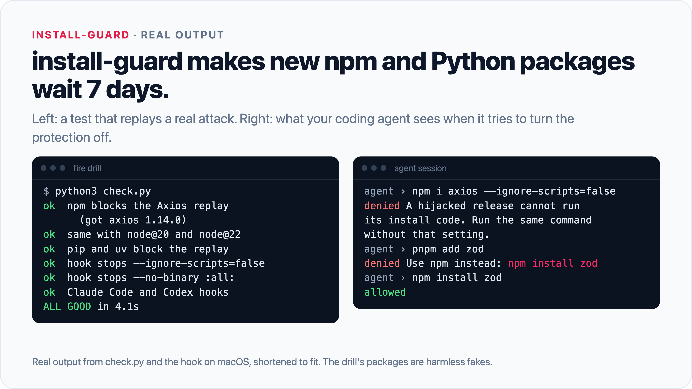
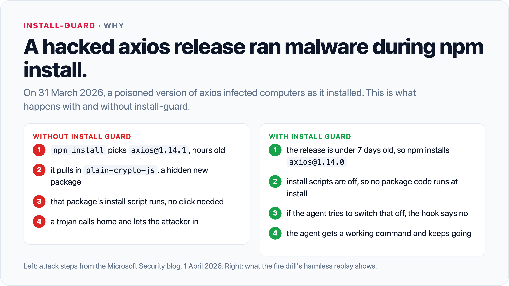
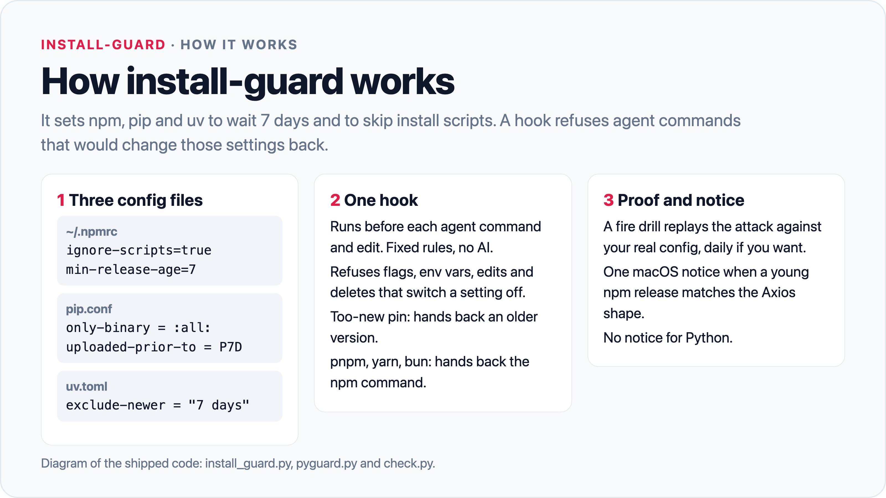

# Install Guard

install-guard makes new npm and Python packages wait 7 days before they install on your Mac, and stops package code from running during install. A hook refuses commands from Claude Code and Codex that would change those settings back.



```sh
git clone https://github.com/AaqifZ/install-guard.git
cd install-guard
./install.sh
```

The installer shows every change it will make and waits for your yes.

## Why

On 31 March 2026, attackers published a poisoned Axios release to npm. A normal `npm install` pulled in a hidden extra package. Its install script dropped a remote-control trojan before anyone looked at the code ([Microsoft Security blog, 1 April 2026](https://www.microsoft.com/en-us/security/blog/2026/04/01/mitigating-the-axios-npm-supply-chain-compromise/)).

Two settings stop that attack shape:

- **No install-time code.** Package install scripts and Python source builds do not run.
- **A 7-day wait.** Your package tools skip any release younger than 7 days. That gives the registry and security researchers time to find and pull a hijacked release before it reaches you.

npm, pip and uv already have both settings. They are off by default, and an agent that hits an error will often switch them off again. Install Guard turns them on and keeps them on, without leaving your agent stuck.





## Requirements

- macOS. The hooks are plain Python and may work elsewhere, but only macOS is tested.
- Node.js with npm. The 7-day wait needs npm 11.10 or later. The installer upgrades older npm to 11.20.0.
- Python 3.9 or later for the hooks. pip needs version 26.1 or later to honor the 7-day wait. Use Homebrew Python (`brew install python`). Apple's `/usr/bin/python3` comes with pip 21, which ignores the 7-day wait. The installer warns you if your pip is too old.
- uv is optional. It was tested with uv 0.12.
- Claude Code, Codex, or both, for the agent hooks.

## Install

1. Clone the repo to a folder you will keep. The hooks run the files from this folder, so do not move it later.
2. Run `./install.sh`. Read the list of changes, then answer `y`.
3. Answer `y` to the second question if you want the daily check (a launch agent). Answer `n` to skip it.

The installer makes these changes for your user only (no sudo):

| What | Change | Backup |
|---|---|---|
| npm | Upgrades to 11.20.0 if older than 11.10. This includes the npm in each Homebrew `node@*` keg. | none |
| `~/.npmrc` | Sets `ignore-scripts=true` and `min-release-age=7`. Keeps other lines. | `~/.npmrc.bak-<date>` |
| `~/.config/pip/pip.conf` | If missing or weaker: replaces it with `only-binary = :all:` and `uploaded-prior-to = P7D`. | `pip.conf.bak-<date>` |
| `~/.config/uv/uv.toml` | If missing or weaker: replaces it with `exclude-newer = "7 days"` and `[pip] only-binary = [":all:"]`. | `uv.toml.bak-<date>` |
| `~/.claude/settings.json` | Adds 4 hooks: `PreToolUse`, `PostToolUse`, `PostToolUseFailure`, `SessionStart`. | `settings.json.bak-install-guard` |
| `~/.codex/hooks.json` | Adds 1 `PreToolUse` hook. | `hooks.json.bak-install-guard` |
| Launch agent (optional) | Writes `~/Library/LaunchAgents/com.aaqifz.install-guard.plist` and loads it. | none |

Note: a pip.conf or uv.toml that is replaced loses its other settings, such as a private index. Copy them back from the backup.

### Remove

1. Delete the Install Guard entries from `~/.claude/settings.json` and `~/.codex/hooks.json`, or restore the `.bak-install-guard` copies.
2. If you loaded the launch agent, run `launchctl bootout gui/$(id -u)/com.aaqifz.install-guard`. Then delete `~/Library/LaunchAgents/com.aaqifz.install-guard.plist`.
3. Restore `~/.npmrc`, `pip.conf` and `uv.toml` from their backups, or remove the lines you do not want.

The hook log is `logs/install-guard.jsonl` in the repo folder. It holds command text and is not tracked by Git.

## Use

After the install, you do nothing. Use your agent as before.

- When an agent tries to switch a protection off, the hook refuses and tells it what to run instead.
- When an agent pins an exact version younger than 7 days, the hook hands it the newest version older than 7 days.
- When a package needs its skipped build step, the hook gives the agent the one allowed command.
- When a young release looks like the Axios attack, you get one macOS notification.

Check your setup at any time:

```sh
python3 install_guard.py --doctor   # prints FAIL and exits 1 if a protection is off
python3 check.py                    # the fire drill; changes nothing outside temp folders
python3 check.py --fix              # repairs drift first, then runs the drill
```

To log decisions without stopping anything, create the file `~/.cache/install-guard/shadow`.

## How it works

**The package tools do the blocking.** The config files above apply to every npm, pip and uv run that reads them: yours, your agent's and your scripts'. They cover the full dependency tree, not only the package you name.

**The hook guards the settings.** `install_guard.py` runs before each agent shell command and file edit. It uses fixed rules, with no AI and no questions to you. It refuses:

- flags and environment variables that switch a protection off, such as `--ignore-scripts=false`, `npm_config_before`, `--no-binary :all:`, a bare `--no-binary` on uv, `uv run`, `uv tool` or `uvx`, or `UV_EXCLUDE_NEWER`;
- flags and environment variables that point the tools at another config: `--userconfig`, `--globalconfig`, `npm_config_userconfig`, `npm_config_globalconfig`, `PIP_CONFIG_FILE`, `UV_CONFIG_FILE` and `XDG_CONFIG_HOME`;
- `npm config` changes and edits to `.npmrc`, `pip.conf`, `uv.toml` or `[tool.uv]` in `pyproject.toml` that weaken a protection;
- `rm`, `mv`, `truncate`, `: >` and other overwrites of `~/.npmrc`, `pip.conf` or `uv.toml`;
- creating `~/Library/Application Support/pip`, because pip on macOS then ignores `~/.config/pip/pip.conf` (`--doctor` also checks for that folder);
- `npm install -g npm@<version>` older than 11.10, which ignores the 7-day wait;
- installs in a project whose own `.npmrc` or `pyproject.toml` weakens a protection;
- pnpm, yarn, bun and corepack, which do not read the npm settings. The agent gets the npm command instead.

Every refusal carries a working next command for the packages it names, so the agent keeps moving. Two narrow exceptions are allowed: `npm rebuild <name> --ignore-scripts=false` for a fixed list of known native packages, and `pip install <name> --no-binary <name>` for one named package. The 7-day wait still applies to both.

**After an npm install, a background check looks for the Axios shape**: a release under 7 days old that adds a brand-new dependency (under 30 days old) with an install script. If it finds one, you get one notification. It says "stopped" if an older version was installed, "ran" if the young release got in, or "check" if the version is unknown.

**If the registry is slow or the hook fails, the command is allowed.** The config files still enforce the protections, and the log records the case.

**The fire drill proves it works.** `check.py` serves harmless copies of the attack from a local fake registry and index. It installs them with your real npm, pip and uv config. Each tool must pick the old safe version, and no payload may run. It also confirms that the hook refuses an agent that switches a protection off, and that the hooks are in place. If the drill fails or is more than 3 days old, the next Claude Code session starts with a warning.

Design decisions and the reasons for them are in [docs/DECISIONS.md](docs/DECISIONS.md).

### Tests

The tests use harmless fakes and temp folders. Run them from the repo root:

```sh
python3 tests/test_rules.py      # 169 rule cases, offline
python3 tests/replay_axios.py    # replays the Axios attack against a fake npm registry (needs npm 11.10+)
python3 tests/replay_python.py   # the same attack shape for pip and uv (needs pip 26.1+ and uv)
```

On the author's Mac (macOS, npm 11.20.0, Python 3.14, pip 26.1.2, uv 0.12.8) the results were 169/169, 14/14 and 13/13. Each replay also runs a control with no protections, and the control fires the payload. The fake payloads only write marker files in a temp folder.

## Limits

Read these before you rely on it.

- **It delays a poisoned release. It does not detect one.** If a poisoned release stays undiscovered for more than 7 days, the wait lets it in.
- **Code still runs when you use a package.** Install scripts and source builds are off, but a poisoned package can run code when it is imported or run. Wheels-only does not stop that.
- **The hook is a guardrail, not a sandbox.** It reads shell commands and file edits from Claude Code and Codex. Code that changes config or calls npm from inside another program, such as a Python script, does not pass through it.
- **Commands you type yourself are not checked by the hook.** The config files still protect them.
- **Codex gets only the before-command hook.** It gets no build hints and no notifications.
- **Notifications cover npm only.** A suspicious Python release is still held back by the wait, but you get no notification.
- **Only the main npm and Homebrew `node@*` kegs are checked.** Node from nvm, volta or fnm is not checked or upgraded.
- **Apple's system pip (Python 3.9, pip 21) ignores the 7-day wait.** It still keeps wheels-only.
- **`uv add`, `uv sync`, `uvx` and `uv tool` can still build from source.** The 7-day wait still applies to them.
- **Direct URL, tarball and git installs skip the 7-day wait.** For example `npm install https://...tgz`, `npm install github:user/repo` or `pip install git+https://...`. They have no registry release date.
- **The hook reads simple shell commands only.** It does not follow pipes into a shell (`curl ... | sh`), `xargs`, `$(...)` command substitution, npm's JavaScript run directly with `node`, or a package script you run by hand later.
- **Other package tools are not covered.** This includes poetry, pdm, pipx, conda, deno, Homebrew, cargo, gem and go, and running `setup.py` directly.
- **`npm ci` installs exactly what the lockfile says.** A lockfile that already holds a poisoned version is not checked.
- **The hook allows what it cannot parse.** A cutoff value in a form it does not recognize, or a registry that does not answer, is allowed and logged. The config files still apply.
- **A hijack with no new dependency causes no notification.** The 7-day wait still holds it back.

## License

MIT. See [LICENSE](LICENSE).

Built with AI coding agents (Claude Code and Codex).
